# Sintetizador digital polifónico con LPC1769

> **Asignatura:** Electrónica Digital III - Universidad Nacional de Córdoba
> **Integrantes:** 
> * Brezzo, Benjamin
> * Rocatagliatta, Agustin Leandro

> **Profesor:** Blasco, Marcos Javier

---

## 🚀 1. Descripción General del Proyecto

El sistema consiste de un sintetizador digital de polifonía de hasta cuatro voces. Será capaz de reproducir notas musicales con distintas tonalidades al cambiar la forma de onda de la nota (cuadrada, rectangular, diente de sierra o sinusoidal). Contará con 4 potenciómetros para controlar los niveles de la envolvente de la ADSR, y se podrá ecualizar el sonido digitalmente. El sonido se podrá escuchar por un auricular con jack de 3.5 mm, y se visualizaran las amplitudes de las bandas de frecuencia en una matriz de LEDs 8x8. También se contará con una interfaz gráfica desde la cual se podrá generar una nueva onda para reproducir. Las características de la onda nueva se enviar a la placa mediante protocolo UART.

### 🎯 Alcances del Proyecto (¿Qué hace y qué NO hace el sistema?)
* **El sistema SÍ es capaz de:**
  * Tocar hasta **4 notas simultáneas** con 8 pulsadores (escala de Do mayor, Do4 a Do5), con asignación de voces cuando se supera la polifonía (voz libre → voz en Release con menor nivel → voz más antigua).
  * Generar cada voz con un oscilador **DDS** propio (acumulador de fase Q16.16, tablas de 256 muestras) y una **envolvente ADSR** propia, actualizada cada 1 ms.
  * Elegir entre **5 formas de onda** (cuadrada, diente de sierra, triangular, sinusoidal y la generada en Python) con un pulsador en EINT1; el cambio se aplica desde la próxima nota.
  * Controlar Attack, Decay, Sustain y Release con **4 potenciómetros** leídos por ADC en modo burst.
  * Mezclar las voces en punto fijo (Q15) con saturación sin wrap-around y un contador de recortes.
  * **Ecualizar** en tiempo real con tres bandas (low-shelf a 200 Hz, peaking a 1 kHz y high-shelf a 4 kHz, de −12 a +6 dB) mediante filtros IIR Biquad en punto fijo.
  * Reproducir el audio por **DAC + GPDMA con doble buffer** (Fs = 32 kHz), con un contador de underruns, y entregarlo a auriculares de 3,5 mm a través de un filtro Sallen-Key (LM358) y un amplificador LM386.
  * Mostrar el **espectro en 8 bandas de una octava** (FFT propia de 512 puntos) en una matriz WS2812B de 8×8, una columna por banda y con el color de la onda seleccionada, manejada con Timer + DMA, sin SPI y sin bloquear el audio.
  * Comunicarse por **UART** (115200 8N1) con una aplicación de escritorio en Python (PySide6) que diseña una onda por síntesis aditiva (solo se editan las amplitudes de hasta 30 armónicos), ofrece configuraciones precargadas de guitarra, piano, órgano y flauta, configura el ecualizador y envía la tabla de la quinta onda y los coeficientes de los filtros.
  * Rechazar tramas UART inválidas (checksum, longitud o rango) sin modificar la onda que está sonando.
* **El sistema NO incluye (Fuera de alcance):**
  * Grabación de voz.
  * Uso de SPI (las matrices se manejan con Timer + DMA) ni de EINT2.
  * Uso de un RTOS: el firmware es un loop principal simple, con el audio generado en la ISR del DMA.
  * Cálculo en punto flotante en el LPC1769: la aplicación calcula los coeficientes del ecualizador.
  * Análisis de sonidos existentes en la aplicación de escritorio.
  * Persistencia de la quinta onda: vive en RAM, por lo que se pierde al reiniciar la placa.
  * Evolución del timbre durante la nota (wavetable variable en el tiempo): queda como ampliación posterior (Bloque 15), sin condicionar la aprobación del sintetizador principal.
  * Salida estéreo real: ambos canales del jack reciben la misma señal.

### ⏩ Posibles Etapas Siguientes (Líneas Futuras)
* **Wavetable variable en el tiempo:** instrumentos formados por varias tablas que evolucionan durante la nota, con transición o interpolación entre ellas y soporte en el editor y en el protocolo UART.
* **Tablas limitadas en banda** para distintos rangos de notas, para eliminar el aliasing de los armónicos altos en lugar de limitar la cantidad de armónicos.
* **Mayor frecuencia de muestreo** (se parte de 32 kHz) y más voces, si el presupuesto de CPU lo permite.
* **Migrar el circuito de protoboard a un circuito impreso (PCB)**, separando la alimentación de la etapa de audio de la de las matrices LED para reducir el ruido.
* **Guardar la quinta onda y los ajustes en memoria no volátil**, para conservarlos al reiniciar.
* **Entrada MIDI o teclado de más octavas**, para tocar con un instrumento real.

---

## 📐 2. Arquitectura del Sistema: Hardware y Software (Común)

### 🔌 Hardware & Interconexión
* **Diagrama de Bloques:**

  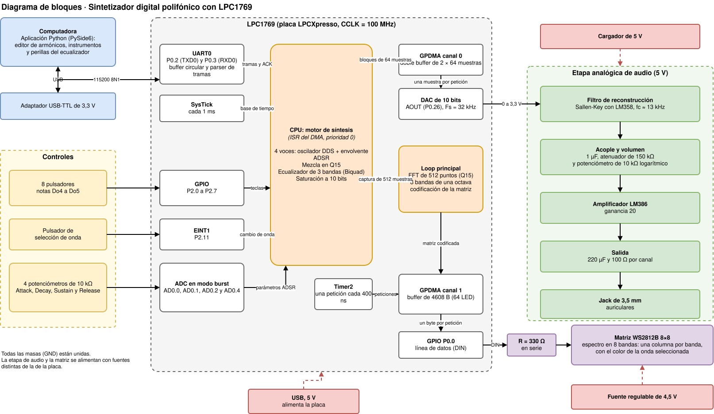

* **Esquemático del Circuito:**

  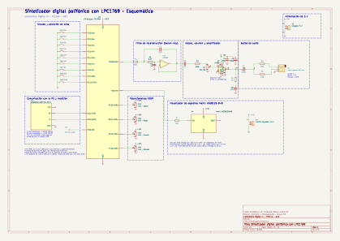

  *Esquemático completo hecho en KiCad (proyecto en `hardware/kicad/`, también en PDF en `hardware/esquematico.pdf`). Los nodos X, F, P5 y S de la etapa de audio son los de `hardware/etapa-audio.md`.*

* **Descripción del Circuito y Consideraciones de Diseño:** armamos el circuito en protoboard, alrededor de una placa LPCXpresso LPC1769. El detalle pin a pin de la etapa de audio y la lista de materiales, con el valor medido de cada componente, están en `hardware/etapa-audio.md`.
  * **Teclas y selección de onda:** conectamos los 8 pulsadores de las notas entre P2.0–P2.7 y GND, y el de selección de onda entre P2.11 (EINT1) y GND. Usamos el pull-up interno de cada pin (son activos en bajo), así que no hacen falta resistencias externas. Tampoco agregamos filtros RC: el antirrebote lo hacemos por software, con 10 ms de estado estable. Las teclas las leemos por sondeo desde SysTick y no con interrupciones de GPIO, para que los rebotes no generen ráfagas de interrupciones que compitan con el audio. Solo el pulsador de onda usa una interrupción externa, por flanco descendente.
  * **Potenciómetros de la ADSR:** usamos cuatro potenciómetros de 10 kΩ, con los extremos a 3,3 V y GND de la placa y el cursor a AD0.0 (P0.23, Attack), AD0.1 (P0.24, Decay), AD0.2 (P0.25, Sustain) y AD0.4 (P1.30, Release). Los alimentamos con 3,3 V y nunca con los 5 V de la etapa de audio, porque en modo ADC esos pines no toleran 5 V. Evitamos AD0.3 porque comparte pin con la salida del DAC (P0.26), y AD0.6 y AD0.7 porque son los pines de UART0.
  * **Comunicación con la PC:** usamos un adaptador USB-TTL de 3,3 V en UART0, con las líneas cruzadas (el TX del adaptador a RXD0 en P0.3 y el RX a TXD0 en P0.2) y GND en común. El VCC del adaptador queda sin conectar, porque cada lado se alimenta por su propio USB.
  * **Salida de audio:** no conectamos el DAC directamente a los auriculares: AOUT entrega de 0 a 3,3 V con 1,65 V de continua, y no puede manejar una carga de baja impedancia. La cadena es AOUT → filtro de reconstrucción → acople → atenuador y volumen → amplificador → jack de 3,5 mm.
    * **Filtro de reconstrucción:** es un Sallen-Key de 2.º orden y ganancia unitaria (R1 = R2 = 8,2 kΩ, C1 = 2,2 nF y C2 = 1 nF), con fc ≈ 13 kHz y Q ≈ 0,74, casi Butterworth. Atenúa la primera imagen de muestreo, que cae en 32 kHz: −15,5 dB con los valores de diseño y −15,96 dB calculados con los valores medidos de los componentes montados.
    * **LM358 alimentado con 5 V:** su entrada y su salida funcionan desde 0 V hasta unos 3,5 V, lo que cubre el rango del DAC sin una fuente negativa. La primera resistencia de 8,2 kΩ respeta la carga mínima de 1 kΩ que admite el DAC. La mitad B del integrado no se usa y queda atada (pin 5 a GND y pin 6 unido al pin 7).
    * **Acople, atenuación y volumen:** el capacitor de 1 µF quita la continua. La resistencia de 150 kΩ y el potenciómetro logarítmico de 10 kΩ bajan los 3,3 Vpp del DAC a unos 170 mVpp como máximo, para que el LM386 no recorte con su ganancia de 20 (unos 3,4 Vpp a la salida).
    * **LM386:** lo elegimos porque, a diferencia del LM358, está pensado para cargas de baja impedancia y se consigue con facilidad. Con los pines 1 y 8 abiertos su ganancia es 20. Lleva 100 nF y 100 µF de desacople junto al pin 6 y la red de 10 Ω + 47 nF a la salida, como en su aplicación típica.
    * **Salida:** el capacitor de 220 µF bloquea los 2,5 V de continua del pin 5. Las resistencias de 100 Ω por canal limitan la potencia a unos 2,6 mW en auriculares de 32 Ω y separan los dos canales, que reciben la misma señal (no es estéreo real).
    * **Validación:** con una senoide de 125 Hz a escala completa y cargas de prueba de 16 Ω medimos 0,168 Vrms (L) y 0,169 Vrms (R) con el volumen al máximo, contra 0,167 Vrms calculados, y 3,6 y 5 mV de continua (el límite que fijamos es 10 mV).
  * **Alimentación y masas:** la LPCXpresso se alimenta por USB, y de sus 3,3 V salen los pull-up internos y los potenciómetros. La etapa de audio usa los 5 V de un cargador aparte: el positivo va solo a la etapa de audio y el negativo se une a GND de la placa, de modo que la masa es común. Así el audio no comparte su línea de alimentación con cargas que metan ruido.
  * **Pines auxiliares:** P0.22 es el LED de la placa, que parpadea con un período de 1 s como prueba de vida. P2.8 es una salida de medición: está en alto mientras la interrupción de audio genera un bloque, para medir su duración con un osciloscopio.
  * **Limitación conocida:** un contacto intermitente entre la placa y la protoboard mete ruido en los auriculares al mover el conjunto. Queda por corregirlo antes de la prueba final; pasar el circuito a un impreso es una de las líneas futuras.

### 💻 Arquitectura de Software (Firmware)
* **Diagrama de Flujo o Máquina de Estados:** el firmware tiene nueve diagramas de flujo: el programa principal, las interrupciones (DMA, SysTick, UART0 y EINT1) y cinco funciones auxiliares (análisis espectral, actualización y envío a la matriz de LEDs, envolvente ADSR y asignación de voces).

  *Programa principal (`main`):*

  

  *Interrupción de audio (`DMA_IRQHandler`, prioridad 0, cada 2 ms):*

  

  *Base de tiempo (`SysTick_Handler`, prioridad 1, cada 1 ms):*

  

  *Recepción UART y selección de onda (`UART0_IRQHandler`, prioridad 2, y `EINT1_IRQHandler`, prioridad 4):*

  

  *Análisis espectral (`analyzeSpectrum`):*

  

  *Matriz de LEDs (`updateMatrix`):*

  

  *Envío de datos a la matriz (`ledMatrixSend`):*

  

  *Envolvente ADSR:*

  

  *Asignación de voces al presionar una tecla (`voiceAllocPress`):*

  

* **Descripción:** el firmware es bare-metal, sin RTOS: un loop principal simple y cuatro interrupciones con prioridades fijas. Lo dividimos en módulos de **hardware**, los únicos que tocan periféricos (siempre mediante los drivers), y módulos de **lógica**, que no acceden a registros, reciben sus datos por parámetro y se prueban en la PC.

  | Capa | Módulos |
  |---|---|
  | Hardware | `sintetizador` (`main`, SysTick y EINT1), `audio_out` (DAC, GPDMA e interrupción de audio), `adc_input`, `button_input` y `uart_link` |
  | Lógica | `oscillator` (DDS), `voice` (asignación de voces), `envelope` (ADSR), `mixer`, `equalizer` (Biquad), `dac_level` (saturación), `block_cursor` (doble buffer), `debounce`, `pot_filter`, `wave_select`, `ring_buffer`, `uart_protocol` y `tables` (tablas generadas con `gen_tables.py`) |

  * **`DMA_IRQHandler` (prioridad 0, cada 2 ms):** es la única interrupción larga, y lo es a propósito: genera el bloque de 64 muestras en la mitad del buffer que quedó libre, mientras el DMA reproduce la otra. Así el audio no depende de lo que esté haciendo el loop principal. Por cada muestra recorre la cadena voces → mezcla → ecualizador → saturación:
    * **Voces:** cada una tiene su oscilador DDS (fase en Q16.16 que da la vuelta en 2^24; el índice de la tabla de 256 muestras son los bits 23:16) y el nivel de su envolvente, ambos en Q15.
    * **Mezcla:** suma los productos muestra × nivel en 32 bits y aplica una ganancia fija de 1/2, de modo que una nota sola usa la mitad del rango del DAC.
    * **Ecualizador:** tres Biquad en cascada (low-shelf, peaking y high-shelf) en forma directa I, con coeficientes Q2.30 y acumulador de 64 bits.
    * **Saturación:** lleva la muestra al rango de 10 bits del DAC (0 a 1023), sin wrap-around, y cuenta los recortes.

    Al terminar comprueba si el DMA ya consumió la otra mitad: si es así, el bloque llegó tarde y se incrementa `audioUnderruns`. Con cuatro voces, sin ecualizador y compilado en Debug medimos 41 573 ciclos por bloque, el 20,8 % de los 199 936 disponibles.
  * **`SysTick_Handler` (prioridad 1, cada 1 ms):** concentra todo lo que depende del tiempo. Filtra los potenciómetros y los convierte en los parámetros de la ADSR (Attack, Decay y Release de 2 a 2000 ms, y Sustain de 0 a 100 %), avanza las cuatro envolventes, lee las teclas con antirrebote de 10 ms y asigna las voces. También rearma el pulsador de onda y hace parpadear el LED de la placa.
  * **`UART0_IRQHandler` (prioridad 2):** solo copia los bytes de la FIFO al buffer circular de 256 B. El parser no corre en la interrupción.
  * **`EINT1_IRQHandler` (prioridad 4):** rota la forma de onda. Acepta el flanco solo si pasaron 150 ms desde la última pulsación aceptada y el pulsador se soltó desde entonces, de modo que un rebote o una pulsación mantenida cuentan una sola vez. La onda nueva se aplica a las notas que arrancan después; las que ya suenan conservan la suya.
  * **Loop principal:** le pasa al parser los bytes recibidos. Con una trama `UPLOAD_WAVE` válida activa la quinta onda, y con una `SET_EQ` válida deja los coeficientes para el próximo bloque de audio; en los dos casos responde ACK. Una trama con el comando, la longitud o el checksum incorrectos se descarta sin modificar nada de lo que está sonando. Cuando no hay bytes pendientes, la CPU duerme con `__WFI` hasta la próxima interrupción.
  * **Datos compartidos entre contextos:** cada dato tiene un solo escritor, y el cambio se hace de forma que la interrupción de audio nunca vea un estado a medio escribir.
    * **Voces:** las escribe solo SysTick, con la IRQ del DMA deshabilitada mientras dura la escritura, porque la interrupción de audio puede interrumpir a SysTick.
    * **Buffer de audio:** el DMA lee una mitad mientras la interrupción llena la otra.
    * **Quinta onda:** se recibe en un buffer aparte y se activa cambiando un puntero, así que nunca se escribe sobre la tabla que está sonando.
    * **Coeficientes del ecualizador:** hay dos juegos. El loop principal escribe el que está libre y publica un puntero, que la interrupción de audio toma al empezar un bloque.
    * **Buffer circular de la UART:** la interrupción escribe y el loop principal lee.
  * **Diagnóstico:** los contadores `audioUnderruns`, `audioSaturations` y `audioIsrMaxCycles` se leen con el depurador, con la CPU suspendida, y P2.8 permite medir la duración de la interrupción de audio con un osciloscopio.
  * **Estado actual:** el ecualizador ya está integrado en la cadena de audio y se configura desde la aplicación; su validación en placa está en curso. La FFT y el manejo de las matrices LED todavía no están implementados: cuando se sumen, van a correr en el loop principal, después del parser, sin agregar trabajo a ninguna interrupción.

---

## ⚡ 3. Especificaciones Eléctricas, Alimentación y Entorno (Específico por Asignatura)

### 🔌 Parámetros de Alimentación y Consumo (Común a ambas materias)
* **Tensión de operación del sistema:** 3,3 V en el LPC1769 y sus entradas/salidas; 5 V en la etapa analógica de audio (LM358 y LM386) y en las matrices WS2812B.
* **Método de alimentación:**
  * Placa LPC1769 y etapa de audio: 5 V por USB.
  * Matrices LED: fuente externa regulable ajustada a 5 V, con masa común con el LPC1769 y en una línea distinta de la del audio.
* **Consumo estimado o medido:**
  * En modo activo (máxima carga, matriz en blanco al 100 %): estimado en ≈ 3,8 A (64 LED a 60 mA), valor que el firmware evita limitando el brillo al 25 % (peor caso ≈ 1 A). Consumo medido: `XX mA` *(a medir en el Bloque 12)*.
  * En modo bajo consumo: no aplica, el sistema no implementa modos de bajo consumo.

* **IDE y SDK:** MCUXpresso IDE 25.6 con CMSIS Core y los drivers de periféricos del proyecto `CMSISv2p00_LPC17xx` (repo `LPC17xx-CMSIS-Driver-Enhancement`). Biblioteca de C: Redlib (semihost).
* **Microcontrolador Principal:** NXP LPC1769 (ARM Cortex-M3, CCLK = 100 MHz).
* **Bibliotecas de Terceros y Versiones:**
  * Firmware: ninguna además de CMSIS y los drivers; la FFT, los filtros Biquad y el protocolo UART son de implementación propia. Sin RTOS.
  * Aplicación de escritorio: Python con PySide6, numpy, pyqtgraph y pyserial (versiones: `XX`, a completar al cerrar el proyecto) y pytest para los tests.
* **Periféricos Avanzados Utilizados:** SysTick (ADSR, potenciómetros y teclas), Timer (generación de peticiones DMA para las matrices), ADC en modo burst (potenciómetros), DAC (audio), GPDMA (canal 0: audio; canal 1: matrices), UART0 (aplicación), GPIO (teclas y línea de datos) y EINT1 (selección de onda), más NVIC, PINSEL y CLKPWR como configuración.
* **Estrategia de Concurrencia:** bare-metal, sin RTOS, con la generación de audio en la ISR del DMA (prioridad máxima) y el trabajo pesado en el loop principal.

  | Contexto | Prioridad NVIC | Tarea |
  |---|---|---|
  | `DMA_IRQn` | 0 | Genera cada bloque de audio (voces, mezcla, ecualizador, saturación) |
  | `SysTick_IRQn` | 1 | Cada 1 ms: ADC, envolventes y teclas |
  | `UART0_IRQn` | 2 | Encola los bytes recibidos (FIFO de 16 B) |
  | `EINT1_IRQn` | 4 | Rotación de la forma de onda |
  | Loop principal | — | Parser UART → FFT → codificación de matrices |

  Las muestras se transfieren con doble buffer: mientras el DMA reproduce un bloque, la ISR genera el otro. Un contador de underruns verifica que el audio nunca se interrumpa. Con Fs = 32 kHz, la ISR del DMA consume cerca del 10 % de la CPU (estimado; se mide en los Bloques 5 y 10).
* **Distribución de memoria:** tablas de las cuatro ondas precargadas, incrementos, ventana Hann y factores de giro en Flash; pila, voces, filtros, FFT, buffer UART y quinta onda en `RamLoc32`; buffers de audio en AHB SRAM banco 0 y buffer de la matriz (≈ 4,6 KB) en AHB SRAM banco 1, para que los dos canales DMA no compitan.

---

## 🔄 4. Proceso de Integración y Desarrollo (Común)
Describan cronológicamente cómo fueron sumando y testeando las diferentes partes del proyecto (enfoque modular de ingeniería).

El desarrollo es incremental: cada bloque se implementa, prueba y aprueba antes de pasar al siguiente, trabajando de a una story por vez. Un bloque se aprueba con todos sus criterios cumplidos y la evidencia guardada en `docs/evidencia/`; si algo aprobado se rompe, se arregla antes de seguir. La lógica se prueba en la PC (gcc y make para el firmware, pytest para la aplicación) y el hardware con mediciones en placa.

* **Etapa 1 (Validación inicial):** *(Bloque 0, completado)* proyecto base en MCUXpresso, verificación del reloj (CCLK = 100 MHz), compilación y descarga, parpadeo del LED de la placa (P0.22) alternado por SysTick, diagnóstico por semihosting, estructura del repositorio y tests de ejemplo en la PC y con pytest.
* **Etapa 2 (Audio de salida):** *(Bloques 1 a 3, pendientes)* DAC con `DACCNTVAL` para Fs = 32 kHz y senoide de prueba, reproducción continua con GPDMA y doble buffer con contador de underruns, y construcción de la etapa analógica (filtro Sallen-Key, LM386 y jack) para poder escuchar los bloques siguientes.
* **Etapa 3 (Síntesis e interacción):** *(Bloques 4 a 7, pendientes)* oscilador DDS, cuatro voces con mezclador y saturación, lectura de las 8 teclas con antirrebote y asignación de voces, rotación de ondas con EINT1, y envolventes ADSR controladas por los potenciómetros vía ADC.
* **Etapa 4 (Aplicación Python y comunicación):** *(Bloques 8 y 9, pendientes)* editor de armónicos con síntesis aditiva, instrumentos precargados, protocolo UART con tramas validadas y transferencia segura de la quinta onda.
* **Etapa 5 (Procesamiento y visualización):** *(Bloques 10 a 13, pendientes)* ecualizador de tres bandas con Biquad en punto fijo, FFT propia de 512 puntos con 8 bandas, control de la matriz WS2812B con Timer + DMA e integración del visualizador de espectro.
* **Etapa 6 (Sistema Completo):** *(Bloque 14, pendiente)* integración de todo, revisión de prioridades y buffers, medición de CPU y memoria, pruebas prolongadas con el contador de underruns en 0 y demostración en placa de la función de cada periférico.

---

## 📊 5. Ensayos, Pruebas y Resultados (Común)
Demuestren con datos empíricos que el sistema funciona correctamente. **Es obligatorio incluir registro visual**.

* **Pruebas Funcionales Realizadas:**
  * **Bloque 0 (realizado):** compilación sin errores, descarga a la placa, prueba de vida con el LED P0.22, diagnóstico por semihosting y ejecución de los tests de ejemplo (gcc en la PC y pytest).
  * **Previstas** (los resultados se completan a medida que se aprueba cada bloque):
    * *DAC y DMA:* medición con osciloscopio de la frecuencia de muestreo y de la señal, y reproducción prolongada con el contador de underruns en 0.
    * *Etapa analógica:* respuesta del filtro, offset de continua y nivel en auriculares, sin clipping.
    * *DDS y voces:* frecuencias medidas frente a las teóricas; mezcla de 1 a 4 voces sin overflow, con el contador de saturaciones.
    * *Teclas y ADSR:* antirrebote, polifonía mayor a 4 notas, tiempos de Attack, Decay y Release, y nivel de Sustain.
    * *UART:* tramas válidas e inválidas, transferencia interrumpida y recepción con el audio sonando.
    * *Ecualizador:* respuesta de cada banda y de la cascada, y estabilidad.
    * *FFT y matrices:* pico de una senoide en la banda esperada, tiempo de ejecución, niveles y tiempos de DIN (pulsos "0" y "1" del WS2812B) medidos con osciloscopio, y consumo con las matrices encendidas.
    * *Sistema completo:* prueba prolongada con todas las funciones activas y demostración de cada periférico exigido en placa.
* **Evidencia Fotográfica y Gráficos:** las mediciones y capturas de cada bloque se guardan en `docs/evidencia/`.
  * *Capturas de instrumental:*

    *Circuito sin la matriz de LEDs:*

    Vista lateral del circuito, sin la matriz de LEDs conectada:

    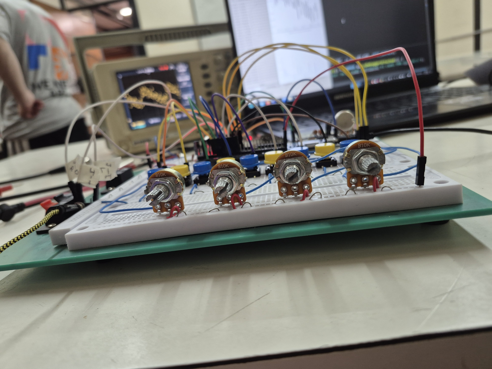

    Vista desde arriba del circuito, sin la matriz de LEDs conectada:

    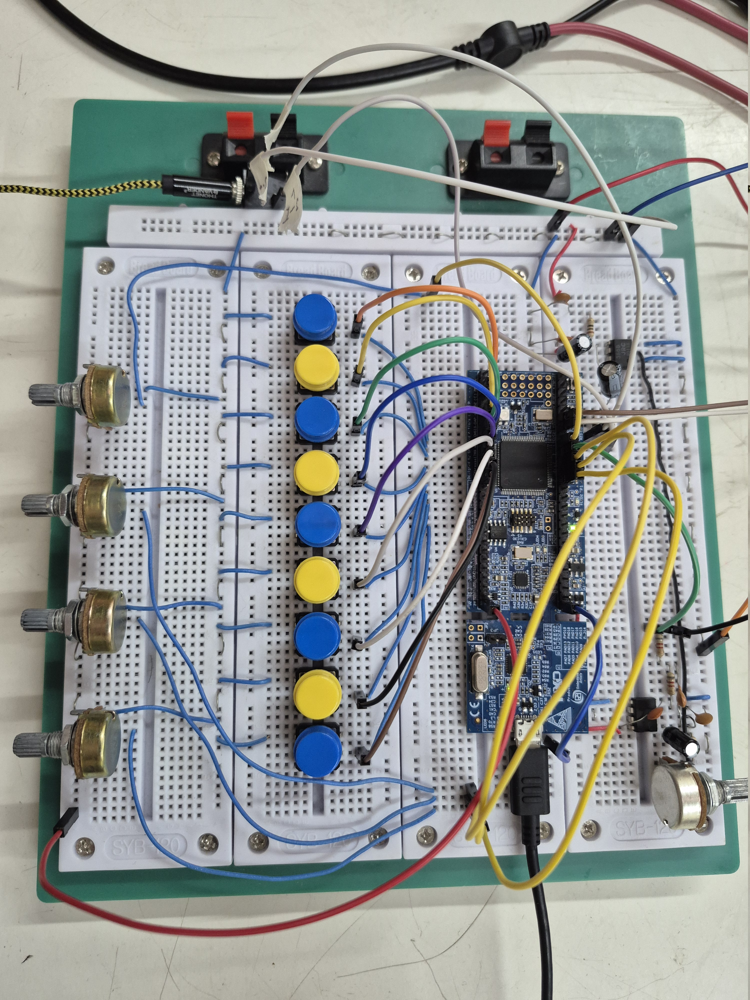

    *Salida del DAC con cada forma de onda (AOUT):*

    Salida del DAC con onda senoidal:

    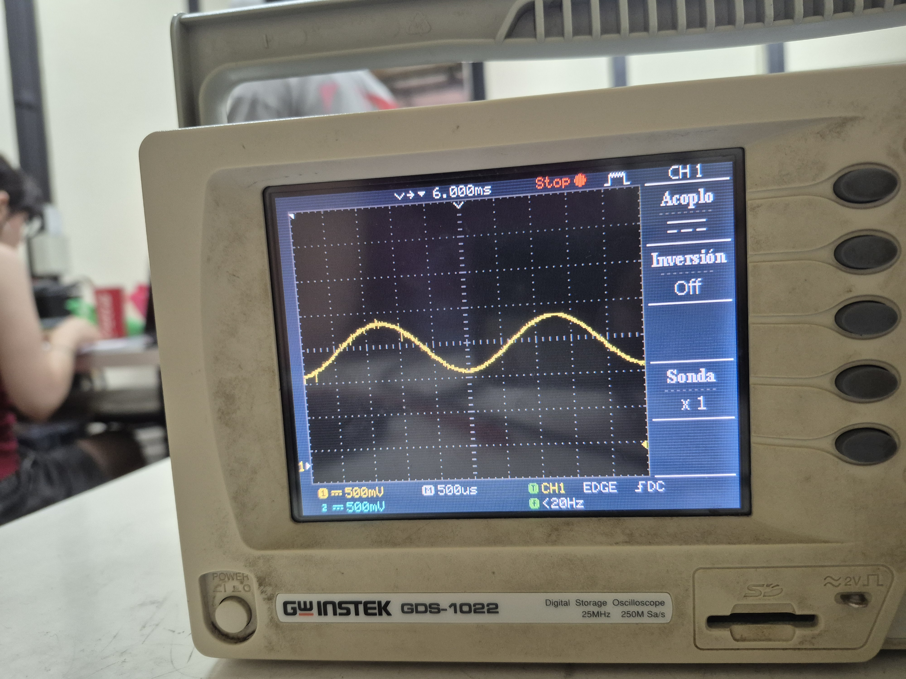

    Salida del DAC con onda cuadrada:

    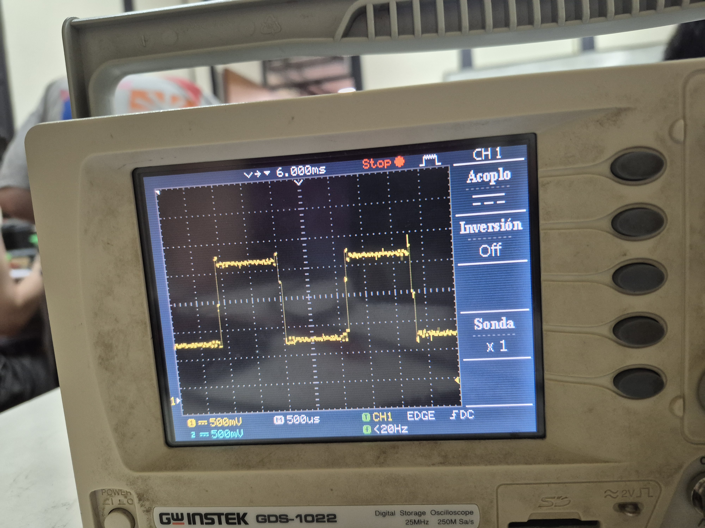

    Salida del DAC con onda de diente de sierra:

    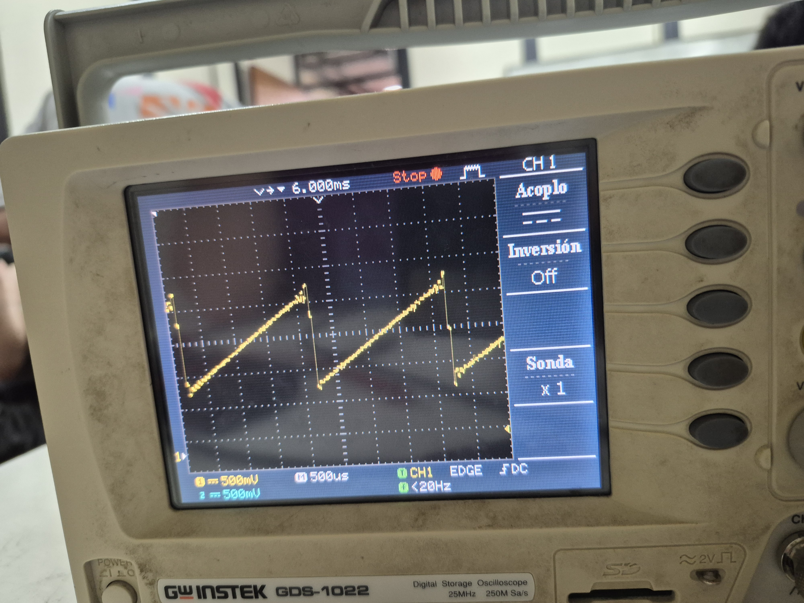

    Salida del DAC con onda triangular:

    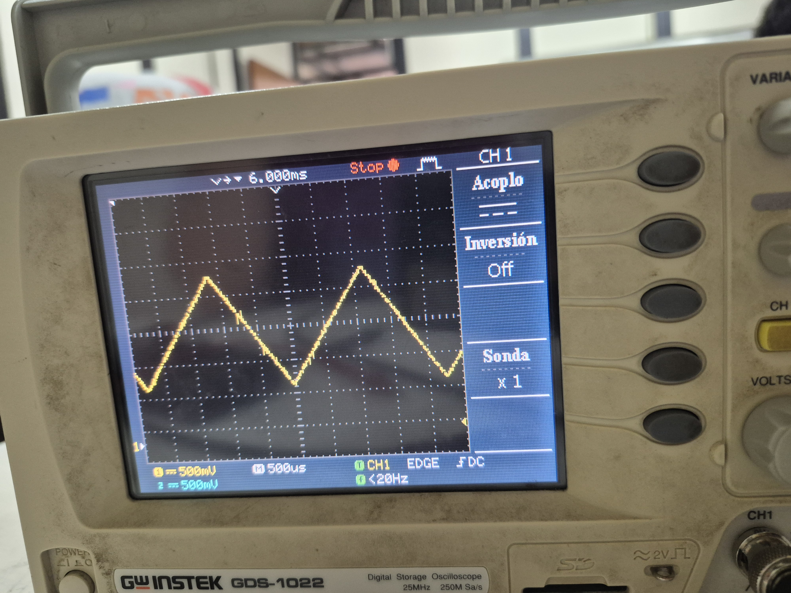

    *Onda cargada desde la app:*

    Onda cargada desde la app, primera captura:

    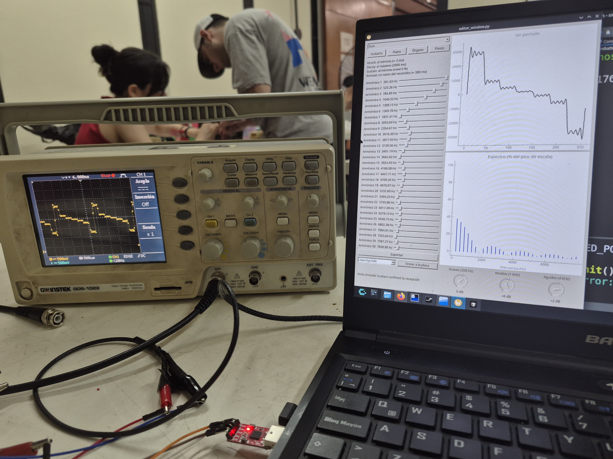

    Onda cargada desde la app, segunda captura:

    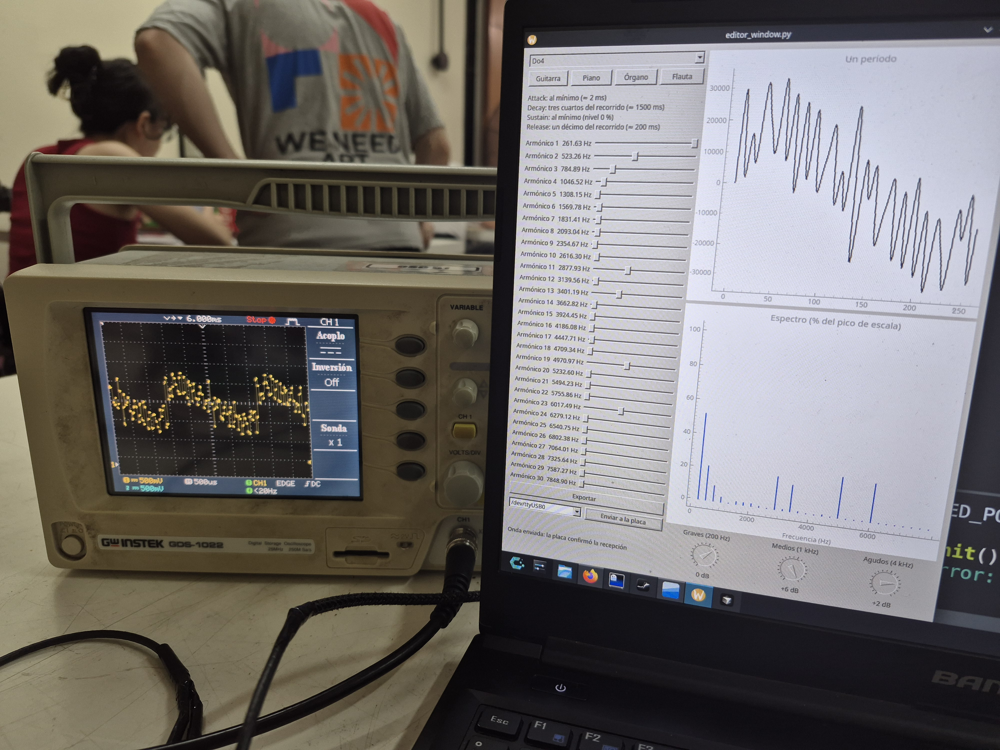

    *Envolvente ADSR con los potenciómetros en distintas posiciones:*

    Todos los potenciómetros de la ADSR al mínimo:

    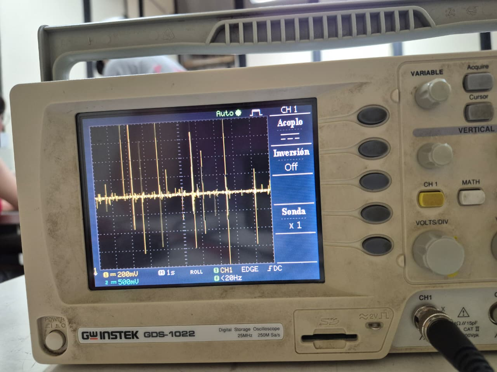

    Todos los potenciómetros de la ADSR al máximo:

    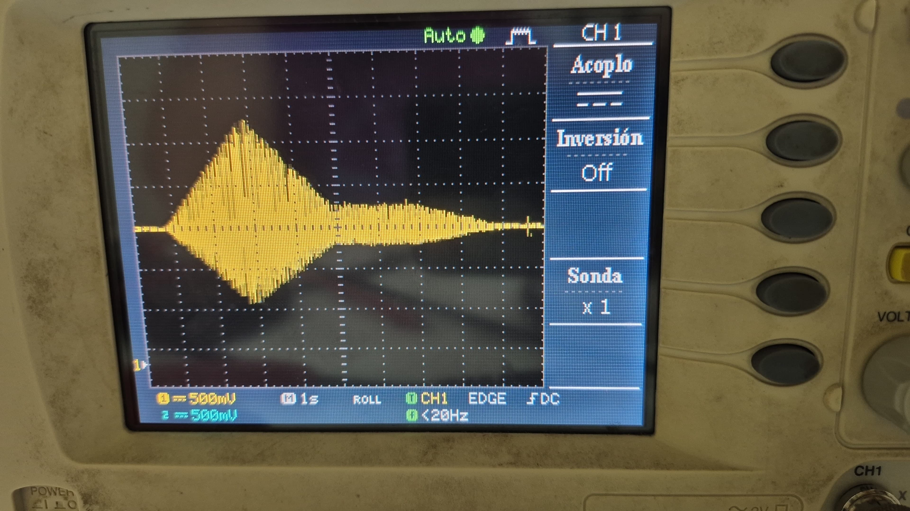

    Sustain al máximo, el resto de los potenciómetros sin cambios:

    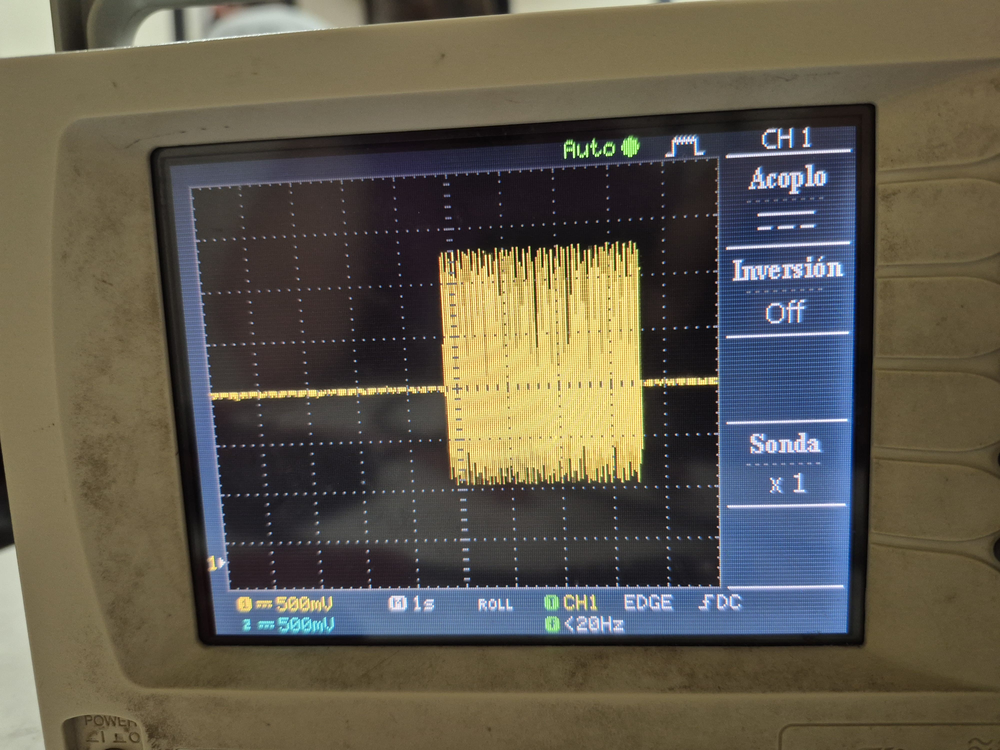

    Attack y Sustain al máximo:

    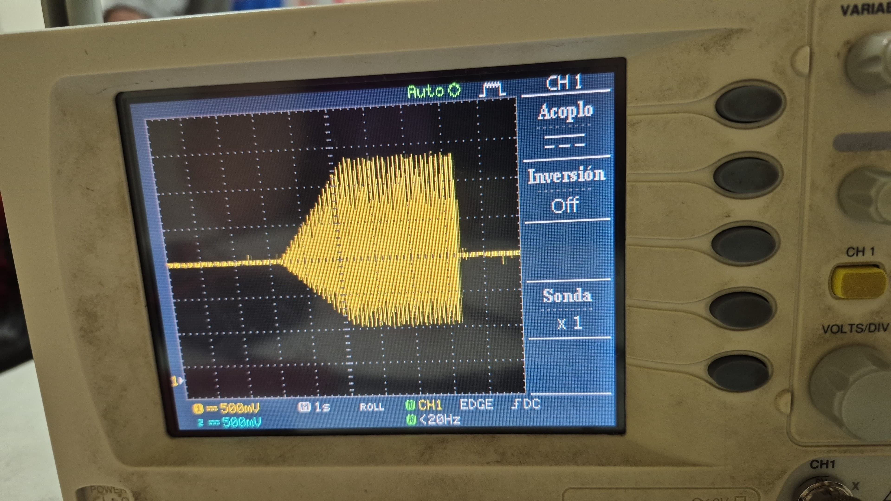

    Attack, Sustain y delay al máximo:

    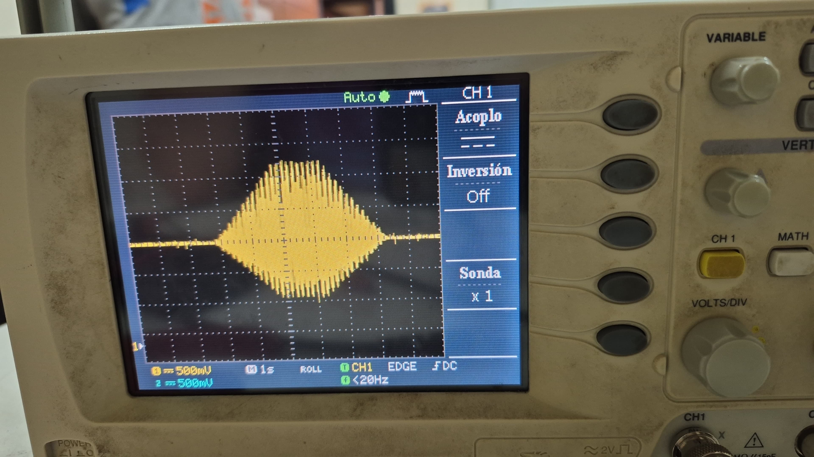

  * *Foto del Prototipo Real:*

    Prototipo armado en protoboard, con la placa LPC1769, la etapa de audio y las teclas:

    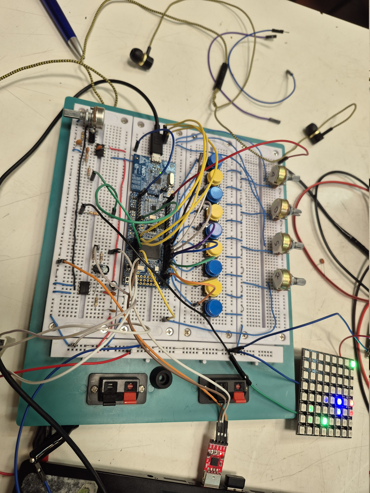

  * *Funcionamiento del proyecto:*

    Animación del sintetizador en funcionamiento, con las teclas, la selección de onda y la matriz de LEDs:

    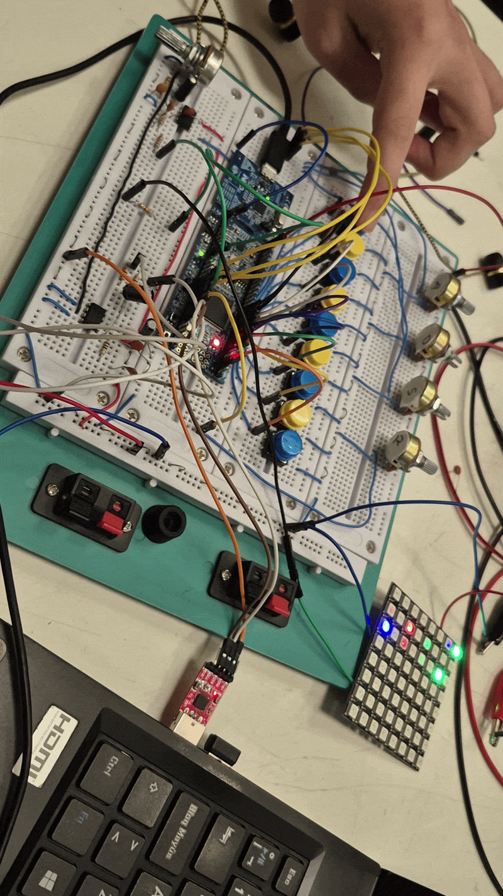

---

## 📂 6. Estructura del Repositorio (Común)
El repositorio debe mantener obligatoriamente la siguiente estructura limpia (¡Recuerden configurar correctamente el `.gitignore` para no subir carpetas temporales como `Debug/`, `Release/` o archivos `.p1` / `.d`!).

```text
├── firmware/          # Código fuente del proyecto (MPLABX / MCUXpresso / STM32Cube)
│   ├── src/           # Archivos de código (.c)
│   └── inc/           # Archivos de cabecera (.h)
├── hardware/          # Archivos de diseño (KiCad/Altium), esquemáticos en PDF/Imagen y BOM
├── docs/              # Datasheets clave, imágenes del README, notas de aplicación
└── README.md          # Este archivo de presentación

